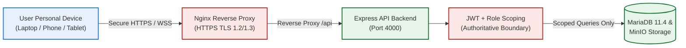

# Bring-Your-Own-Device (BYOD) Policy
**Document Code:** SWU_008  
**Organization:** Southwestern University PHINMA — Community Development Department (ComDev)  
**System:** First 1,000 Days (F1KD) Digital Health Monitoring System  
**Date:** September 14, 2026 (Updated: October 26, 2026)  
**Version:** 1.1  

---

## 1. Introduction, Purpose, Scope, and Applicability

### Introduction
This policy provides guidelines for using personal devices when accessing the First 1,000 Days (F1KD) Digital Health Monitoring System for program-related work. It aims to ensure that personal devices are used safely and responsibly when handling sensitive maternal, neonatal, and child health information.

### Purpose
The purpose of this policy is to establish clear rules for how personal devices may be used, identify user responsibilities, and protect program information. It supports compliance with organizational standards and Republic Act No. 10173 (Data Privacy Act of 2012).

### Scope
This policy applies to all authorized users of the F1KD Digital Health Monitoring System who access the system or program information using personal devices across the five implemented roles:
* **Super Admin**
* **Administrator**
* **Community Coordinator** (also designated as **Community Organizer** in system interfaces)
* **Health Worker**
* **Partner** (Community Partner)

### Applicability
This policy covers all personally owned devices, including smartphones, tablets, laptops, and desktop computers, used to access the F1KD Digital Health Monitoring System or its associated data. Personal devices are devices owned by the user and not provided by Southwestern University PHINMA or the Community Development Department (ComDev).

---

## 2. Definition of Terms

* **BYOD (Bring Your Own Device):** The practice of allowing authorized personnel to use their personally owned devices to access the F1KD Digital Health Monitoring System for approved program tasks.
* **Personal Device:** Any privately owned smartphone, tablet, laptop, or desktop used to interact with the F1KD web application or store temporary exported reports.
* **Sensitive Data:** Information that requires rigorous legal and technical protection, specifically:
  * **Program Data:** Aggregate community indicators, operational progress figures, program cluster definitions, and monitoring logs.
  * **Personal Information:** Information that directly or indirectly identifies individuals, such as full names, contact numbers, birth dates, and residential addresses.
  * **Sensitive Personal Information (SPI):** Highly protected health data, including pregnancy histories (LMP, EDD, obstetric risk factors), maternal and pediatric check-up vitals, immunization doses, nutritional status, PhilHealth Identification Numbers (PIN), and PhilHealth claim records.
* **Authorized User:** An individual who holds an active, verified account and has been granted authenticated session access under one of the system’s canonical roles.

---

## 3. Roles and Responsibilities – Governance Structure

### 1. Super Admin
The Super Admin oversees system-wide governance, security compliance, and user account lifecycles.
* Holds exclusive authority to create, update, suspend, reactivate, and permanently delete accounts across all roles.
* Manages global School/Community definitions (`communities` table).
* Oversees device security compliance and investigates unauthorized access attempts.
* **Boundary:** Excluded from operational modules (Beneficiaries, Monitoring, Programs, Progress Reports).

### 2. Administrator
The Administrator provides executive oversight and institutional monitoring across all operational data.
* Reviews operational records across all schools and groups via read-only access.
* Ensures operational staff adhere to data privacy and BYOD standards.
* Assists with operational concerns and escalates technical incidents to the Super Admin.
* **Boundary:** Strictly read-only; cannot alter operational data, register beneficiaries, or administer user accounts.

### 3. Community Coordinator (Community Organizer)
The Community Coordinator manages field operations within an assigned school scope (`school_id`).
* Registers mothers and children, records clinical check-ups, and manages programs within the assigned school.
* Manages Health Worker user accounts belonging strictly to the assigned school.
* Uploads required photo documentation sets (3–10 photos per submission) for batches and program check-ins.
* Ensures personal devices used by assigned Health Workers meet security guidelines.
* **Boundary:** Cannot create or delete schools; cannot access records outside the assigned school.

### 4. Health Worker
The Health Worker performs frontline community monitoring within an assigned school and group scope (`group_id`).
* Uses personal mobile devices or laptops to record maternal and pediatric check-ups and immunization visits.
* Records program distribution receipts (`PATCH /api/programs/:id/monitoring`) for assigned group beneficiaries.
* Maintains device lock screens and encrypts credentials when operating in field settings.
* **Boundary:** Cannot register new beneficiaries; cannot manage user accounts; cannot create programs; cannot modify records outside the assigned group.

### 5. Partner (Community Partner)
The Partner reviews program collaboration progress and community metrics.
* Uses personal devices to inspect approved program delivery data, community indicators, and progress reports.
* Maintains strict confidentiality of downloaded reports.
* **Boundary:** Strictly read-only; cannot create, edit, or delete operational data.

---

## 4. Guidelines

### 4.1 Acceptable Use
* **Approved Activities Only:** Personal devices must only be used for approved F1KD program tasks, including clinical data entry, attendance logging, report generation, and scheduling.
* **Prohibited Activities:**
  * Attempting to bypass backend API authorization or school/group scoping rules.
  * Extracting, photographing, or saving unencrypted beneficiary SPI (e.g., PhilHealth PINs, medical histories) to personal local drives or unauthorized cloud storage.
  * Sharing system login credentials with family members, peers, or unauthorized personnel.
  * Leaving an active, authenticated session unattended in a public or field environment.

### 4.2 Device Registration & Security Controls
* **Device Registration:** Users must register personal devices used for regular data collection with the Community Development Department or Super Admin.
* **Screen Lock & Biometrics:** Personal devices must have an automated screen lock set to engage after no more than five (5) minutes of inactivity, secured via PIN, strong password, or biometrics.
* **Software Updates:** Devices must run supported operating systems (Android, iOS, Windows, macOS) with the latest security patches and an up-to-date modern web browser (Chrome, Edge, Firefox, Safari).
* **Storage Encryption:** Device storage encryption (e.g., BitLocker, FileVault, or mobile OS hardware encryption) should be enabled where supported.

### 4.3 Data Privacy & Export Management
* **Authoritative Storage:** All clinical and operational data must reside within the authorized MariaDB database and MinIO storage cluster.
* **Export Handling:** Progress Report CSV exports downloaded to personal devices contain personal and sensitive personal information. Users must:
  * Store downloaded files in an encrypted folder.
  * Delete temporary report files as soon as the approved administrative task is complete.
  * Never transmit exported reports via unencrypted personal messaging apps (e.g., Facebook Messenger, personal WhatsApp).
* **Auditability:** Progress Report exports trigger an automated audit log (`download.progress_report.csv`) recording the user ID, timestamp, and scope.

### 4.4 Incident Reporting & Lost Devices
* Users must immediately report lost or stolen personal devices that hold active F1KD sessions or downloaded reports to the Super Admin or Community Coordinator.
* The Super Admin shall immediately revoke active JWT authentication tokens and suspend the affected account until device containment is verified.

---

## 5. Technical Architecture & Network Security

* **Backend Enforcement:** The backend API is the authoritative security boundary. Client-side route visibility or hidden UI buttons do not determine security; every API call independently validates authentication, role permissions, and school/group scope.
* **Secure Transmission:** All traffic between personal devices and the F1KD platform must be encrypted via HTTPS using TLS 1.2 or TLS 1.3.

---

## 6. Violations and Enforcement

* **Minor Violations:** Failure to maintain updated browser software, failure to lock screens when stepping away briefly, or delayed device registration.  
  * *Consequence:* Verbal warning, mandatory security re-orientation, and temporary suspension of mobile access until compliant.
* **Major Violations:** Bypassing authorization controls, sharing credentials, unauthorized disclosure or export of beneficiary SPI, or failing to report a stolen device containing confidential health data.  
  * *Consequence:* Immediate revocation of system access, account suspension, formal administrative disciplinary action under university employment/internship policies, and potential legal prosecution under RA 10173.

---

## 7. Policy Governance, Review, and Adoption

* **Annual Review:** This policy shall be reviewed annually by the Community Development Department and the IT governance committee.
* **Adoption and Effectivity:** This policy takes effect immediately upon approval by Southwestern University PHINMA Community Development Department leadership.

---

## 8. Revision History

| Rev No. | Date | Description of Revision | Approved By |
|:---:|:---:|---|---|
| **00** | September 14, 2026 | Initial BYOD Policy Draft. | ComDev Committee |
| **01** | October 26, 2026 | Synchronized with verified system implementation: aligned 5 canonical roles, detailed 3–10 batch photo rules, explicit backend API enforcement, and automated export auditing. | ComDev / IT Governance |

---

## 9. Document Sign-Off

| Role | Name & Designation | Signature | Date |
|---|---|---|---|
| **Prepared by:** | Teodoro, Edzhel M. — Lead Developer / Researcher | ____________________ | 2026-10-26 |
| **Prepared by:** | Laurea, Angelica C. — Systems Analyst / Researcher | ____________________ | 2026-10-26 |
| **Reviewed by:** | IT Department Lead / Information Security Officer | ____________________ | 2026-10-26 |
| **Approved by:** | Booc, Smith — Client / Program Head, ComDev SWU | ____________________ | 2026-10-26 |
