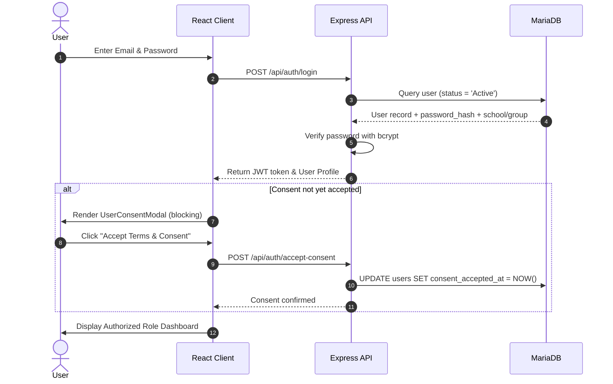
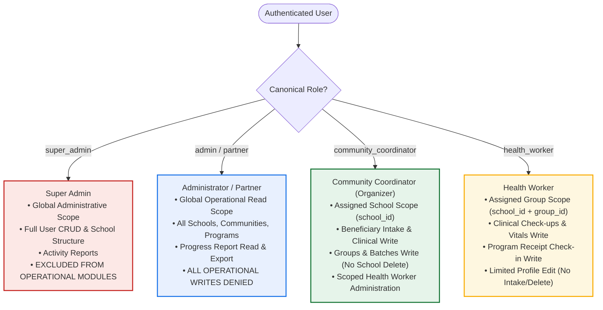
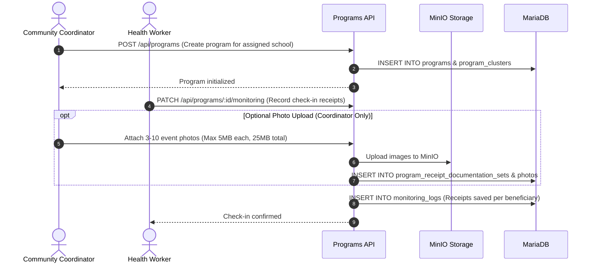

# F1KD Digital Health Monitoring System: Full Manual Guide
**Organization:** Southwestern University PHINMA — Community Development Department (ComDev)  
**Program:** First 1,000 Days (F1KD) Program  
**Version:** 1.1  
**Date:** October 26, 2026  
**Document Owners:** Teodoro, Edzhel M. & Laurea, Angelica C.  

---

## TABLE OF CONTENTS
1. Introduction
   1.1 Purpose of the Manual  
   1.2 About the First 1,000 Days Program  
   1.3 About the Digital Health Monitoring System  
   1.4 Intended Users & Canonical Roles  
   1.5 System Requirements & Technology Stack  
2. Getting Started
   2.1 Accessing the System  
   2.2 Signing In & Server-Validated Sessions  
   2.3 Mandatory Privacy Consent Gating  
   2.4 Signing Out & Session Invalidation  
   2.5 Account Security & Password Policies  
3. User Roles, Scopes, and Access Boundaries
   3.1 Super Admin (`super_admin`)  
   3.2 Administrator (`admin`)  
   3.3 Community Coordinator / Community Organizer (`community_coordinator`)  
   3.4 Health Worker (`health_worker`)  
   3.5 Partner (`partner`)  
4. System Dashboard
5. Communities (Schools, Groups, Batches, and Photo Evidence)
6. Beneficiaries (Mothers, Children, and PhilHealth Records)
7. Monitoring (Maternal Check-ups, Child Check-ups, Immunization)
8. Programs (Program Scopes, Delivery, and Check-In Photos)
9. Progress Report (Filtering, WHO Growth Standards, and Audited Exports)
10. User Management & Account Lifecycle
11. Reports Module (Sign-In History and System Activity)
12. Notifications & Automated Reminder Scheduling
13. Integrated AI Assistants & Privacy Safeguards
14. Data Privacy, Storage, and Security
15. Using Personal Devices (BYOD & AUP Guidelines)
16. System Support, Escalation, and Incident Reporting
17. Frequently Asked Questions & Glossary
18. Role-Based User Manuals & Step-by-Step Procedures
    18.1 Super Admin Manual  
    18.2 Administrator Manual  
    18.3 Partner Manual  
    18.4 Community Coordinator / Organizer Manual  
    18.5 Health Worker Manual  
    18.6 Master Module Access & Permission Matrix  

---

## 1. INTRODUCTION

### 1.1 Purpose of the Manual
This manual provides users with clear instructions on how to use the F1KD Digital Health Monitoring System. It explains the system's features, user responsibilities, data privacy practices, and procedures for handling common system concerns.

### 1.2 About the First 1,000 Days Program
The First 1,000 Days program focuses on supporting the health, development, and nutritional well-being of mothers and children from pregnancy until the child reaches two years of age (24 months), in alignment with Philippine national health frameworks.

### 1.3 About the Digital Health Monitoring System
The F1KD Digital Health Monitoring System is a centralized web platform designed to help the Southwestern University PHINMA Community Development Department manage beneficiary profiles, monitor health visits, track immunization milestones, administer feeding programs, and generate verifiable progress reports in one organized system.

### 1.4 Intended Users & Canonical Roles
The system is intended exclusively for authorized users operating under five canonical roles:
1. **Super Admin (`super_admin`):** Platform-wide administrator responsible for user account lifecycle, school creation, and system activity logs.
2. **Administrator (`admin`):** Institutional leadership role providing global read-only oversight across all schools and operational records.
3. **Community Coordinator (`community_coordinator`):** Field operations lead managing beneficiary intake, clinical monitoring, program setup, and local health workers within an assigned school. (The user interface uses **Community Organizer** as an alias for this role).
4. **Health Worker (`health_worker`):** Frontline community worker performing clinical measurements, child monitoring, and program receipts within an assigned school and group.
5. **Partner (`partner`):** Community partner organization reviewing collaborative program records and community health progress under global read-only access.

### 1.5 System Requirements & Technology Stack
* **Frontend:** React Single Page Application (SPA) built with Vite and role-based route navigation.
* **Backend API:** Node.js Express REST API server running on port 4000.
* **Database:** MariaDB 11.4 relational database accessed via the MySQL-compatible `mysql2` client.
* **Object Storage:** MinIO S3-compatible storage cluster for beneficiary documents and documentation photos.
* **Client Requirements:** Desktop, laptop, tablet, or smartphone running a supported web browser (Google Chrome, Microsoft Edge, Mozilla Firefox, or Apple Safari) with internet connectivity.

---

## 2. GETTING STARTED

### 2.1 Accessing the System
Open a supported web browser and navigate to the application address. Enter your registered credentials on the sign-in screen.

### 2.2 Signing In & Server-Validated Sessions
1. Enter your registered email address.
2. Enter your account password.
3. Click **Sign In**.
4. The system validates the credentials against bcrypt hashes in the database. Upon verification, the server issues a JSON Web Token (JWT) that encodes your user ID, canonical role, and school/group assignments.

### 2.3 Mandatory Privacy Consent Gating
On initial sign-in, or when privacy terms are updated, the application renders a non-dismissible `UserConsentModal`.
* The user must review the data privacy notice complying with the Data Privacy Act of 2012 (RA 10173).
* Clicking **Accept Terms and Privacy Policy** triggers `POST /api/auth/accept-consent`, recording `consent_accepted_at` in the database.
* All protected operational modules remain inaccessible until consent is confirmed.

### 2.4 Signing Out & Session Invalidation
Always sign out when leaving your workstation, especially on shared or personal devices:
1. Open the user profile menu in the upper-right corner.
2. Select **Sign Out**.
3. The client clears the local JWT token and redirects to the sign-in screen.

### 2.5 Account Security & Password Policies
* Passwords must be at least 8 characters long and contain both letters and numbers.
* Accounts are locked after 5 consecutive failed login attempts via the backend rate limiter (`LOGIN_RATE_LIMIT_MAX`).
* Users must never write down, expose, or share passwords.

---

## 3. USER ROLES, SCOPES, AND ACCESS BOUNDARIES

---

## 4. SYSTEM DASHBOARD
The Dashboard provides an immediate operational overview tailored to the user's role:
* **Super Admin Dashboard:** Account totals, active schools, sign-in frequencies, and administrative notifications. Operational clinical cards are excluded.
* **Administrator Dashboard:** Global operational metrics including total registered mothers and children, active programs, upcoming check-ups, and progress indicators across all communities.
* **Community Coordinator Dashboard:** School-specific metrics displaying registered beneficiaries in the assigned school, local active batches, and health worker status.
* **Health Worker Dashboard:** Group-specific indicators displaying check-ups due within 3 days, check-ups due today, missed check-ups, and assigned program shortcuts.
* **Partner Dashboard:** Emphasizes collaborative program coverage, community participation indicators, and progress report links.

---

## 5. COMMUNITIES (SCHOOLS, GROUPS, BATCHES, PHOTO EVIDENCE)

### Hierarchy and Ownership
1. **School / Community Level (`communities`):** Created and deleted exclusively by Super Admin. Community Coordinators cannot create or delete schools (`isSchoolCreate` and `isSchoolDelete` blocked with HTTP 403). Each school is bound to exactly one coordinator via `communities.coordinator_id`.
2. **Group Level (`groups`):** Operational units within a school. Created and managed by Community Coordinators for their assigned school. Health Workers are assigned to a specific group.
3. **Batch Level (`batches`):** Cohorts of beneficiaries within a school. Created and managed by Community Coordinators.
4. **Batch Photo Evidence (`batch_documentations`):** Community Coordinators can upload dated photo documentation sets for batches:
   * **Photo Count:** Exactly **3 to 10 photos** per upload set.
   * **File Constraints:** Supported formats are JPG, PNG, and WEBP. Maximum **5 MB** per individual file; maximum **25 MB** total payload.
   * **Permissions:** Community Coordinators can upload and delete photos. Admin, Partner, and Health Worker accounts have view- and download-only access.

---

## 6. BENEFICIARIES (MOTHERS, CHILDREN, PHILHEALTH RECORDS)

### 6.1 Mother Registration & Records (`mothers`)
* **Intake Authority:** Community Coordinators only. Health Workers and Administrators cannot register new mothers.
* **Key Fields:** Full name, maiden surname, DOB, civil status, contact number, emergency contact, Last Menstrual Period (LMP) date, Estimated Date of Delivery (EDD, calculated via Naegele's rule), obstetric history (Gravida, Para, Abortions, Stillbirths, Miscarriages), and high-risk pregnancy screening.
* **Initial Check-up Generation:** Registering a mother automatically creates the first prenatal checkup record (`mother_checkups`) containing the baseline measurements.

### 6.2 PhilHealth Information & Claims (`philhealth_claims`)
* **PhilHealth PIN Validation:** The system strictly validates PhilHealth numbers using the 12-digit standard format: `XX-XXXXXXXXX-X`.
* **Claims Module:** Authorized staff can track PhilHealth claim records (`GET/POST/PUT /api/mothers/:id/claims`), recording tracking numbers, claim status, and financial assistance amounts.

### 6.3 Child Registration & Records (`children`)
* **Intake Authority:** Community Coordinators only. Children are registered under an existing mother record, inheriting the mother's school and group.
* **Key Fields:** Child code (`CHD-XXXX`), birth date, birth weight (kg), birth length (cm), head circumference (cm), chest circumference (cm), delivery type, and APGAR score.
* **Health Worker Updates:** Health Workers can update vital measurements, feeding notes, and contact information for children in their assigned group, but **cannot register new child records or delete existing records**.

---

## 7. MONITORING (MATERNAL, PEDIATRIC, IMMUNIZATION)

### 7.1 Maternal Check-ups (`mother_checkups`)
Tracks prenatal monitoring across trimesters:
* Visit date, gestational age in weeks, blood pressure (validated format and clinical ranges), weight (kg), fundal height (cm), fetal heart rate (bpm), laboratory requests, milk subsidy distribution, and hospital referrals.

### 7.2 Child Check-ups (`child_checkups`)
Tracks growth monitoring visits through 24 months:
* Visit date, child weight (kg), length/height (cm), head circumference (cm), exclusive breastfeeding status, developmental screening status (Normal, Needs Follow-up, At Risk), service provider, and next scheduled check-up date.
* **WHO Growth Standards:** The system automatically calculates age in months and evaluates anthropometric z-scores using World Health Organization standards:
  * Length-for-Age (Stunting status)
  * Weight-for-Age (Underweight status)
  * Weight-for-Length (Wasting status)

### 7.3 Immunization Records
* **Child Vaccinations (`child_vaccinations`):** Tracks administered doses 1–3 for BCG, Hepatitis B, IPV, OPV, PCV, DPT, and MMR. The API validates chronological date sequences and rejects future dates.
* **Maternal Vaccinations (`mother_vaccinations`):** Tracks Tetanus Toxoid doses TT1 through TT5, Influenza, Hepatitis, and COVID-19 vaccinations.

---

## 8. PROGRAMS (PROGRAMS, CLUSTERS, CHECK-IN PHOTOS)

* **Program Setup:** Community Coordinators define programs and assign target clusters (school, group, or batch). Super Admin is denied access (HTTP 403).
* **Service Check-Ins:** Community Coordinators and assigned Health Workers record beneficiary receipts (`PATCH /api/programs/:id/monitoring`). Health Workers can only record receipts for beneficiaries belonging to their assigned group.
* **Check-In Photo Documentation:** Community Coordinators can attach 3–10 photos per submission. Images are stored in MinIO. Admin, Partner, and Health Worker roles have view- and download-only permissions.

---

## 9. PROGRESS REPORT (FILTERING, EXPORT AUDITING)
* **Operational Reporting:** Provides comprehensive data aggregation across maternal profiles, child growth records, immunization statuses, and program deliveries.
* **Filtering:** Accessible to Administrator, Partner, Community Coordinator, and Health Worker accounts, with data constrained to the user's authorized scope. Super Admin is denied access (HTTP 403).
* **Export Auditing:** Downloading a CSV report or printing triggers an automated audit call (`POST /api/notifications/download-success`), which records `download.progress_report.csv` in `activity_logs`.

---

## 10. USER MANAGEMENT & ACCOUNT LIFECYCLE
* **Super Admin Full Administration (`/api/users`):**
  * Create, edit, toggle status (Active/Suspended), and permanently delete accounts across all roles.
  * Assign Community Coordinators to schools (enforcing 1-to-1 binding) and Health Workers to schools and groups.
  * Super Admin credentials cannot be deleted through standard operational interfaces.
* **Community Coordinator Scoped Administration (`/api/users/health-workers`):**
  * Create, view, edit, suspend, and reactivate Health Worker accounts belonging strictly to their assigned school.
  * **Cannot permanently delete accounts.** Cannot administer accounts in other schools or of other roles.
* **Role Aliases:** Frontend and backend normalize aliases (`superadmin` -> `super_admin`, `administrator` -> `admin`, `community organizer`/`coordinator` -> `community_coordinator`, `healthworker` -> `health_worker`).

---

## 11. REPORTS MODULE (SIGN-IN & SYSTEM ACTIVITY)
* **Access Boundary:** Accessible exclusively by Super Admin via `/reports`.
* **Operational Login Statistics:** Displays user sign-in frequency. Super Admin sign-in events are excluded from user login totals to prevent skewing operational activity reports.
* **Activity Audit Trail:** Displays system events (account creation, profile modifications, check-up entries, report downloads) with actor user ID, entity type, and timestamp.
* **Coordinator Activity API:** Community Coordinators can query activity logs for Health Workers in their school via `/api/reports/activity?actorUserId=...`.

---

## 12. NOTIFICATIONS & AUTOMATED REMINDER SCHEDULING

### 12.1 Daily Reminder Scheduler (`checkupReminders.js`)
* **Execution:** Runs automatically every morning at **08:00 AM (Asia/Manila time)**.
* **Evaluation:** Scans `next_checkup_date` across `mother_checkups` and `child_checkups`.
* **Four Notification Stages:**
  1. **Upcoming Check-Up (3 days before):** Alert sent 3 days prior to scheduled visit.
  2. **Check-Up Tomorrow (1 day before):** Reminder sent 1 day prior to scheduled visit.
  3. **Check-Up Due Today (Day of visit):** Alert sent on the morning of scheduled visit.
  4. **Missed Check-Up (1 day overdue):** Warning sent 1 day after scheduled visit if no completed check-up was recorded.
* **Exclusions:** Excludes beneficiaries with `cancelled`, `inactive`, or `archived` status, or visits where a check-up was already completed on or after the scheduled date.
* **Targeting:** Reminders are routed specifically to the assigned school coordinator and group health workers.

### 12.2 Per-User Read Receipts & Category Preferences
* **Read Receipts (`notification_reads`):** Uses a composite primary key (`notification_id`, `user_id`) so that one staff member reading an alert does not clear it for colleagues.
* **Preferences (`notification_preferences`):** Users can toggle visibility for supported categories (e.g., Beneficiaries, Monitoring, Programs, Downloads).

---

## 13. INTEGRATED AI ASSISTANTS & PRIVACY SAFEGUARDS
When configured with Groq API credentials, F1KD provides three optional, advisory AI assistants:
1. **Dashboard Insights (`/api/progress-report/ai/dashboard-insight`):** Summarizes aggregate metrics. Available to all roles including Super Admin.
2. **Report Proposal Builder (`/api/progress-report/ai/proposal`):** Maps natural language requests to report filters. Available to operational roles; **denied to Super Admin (HTTP 403)**.
3. **Monitoring Check-Up Assistant (`/api/progress-report/ai/monitoring-report`):** Interprets filter requests for check-up tables. Available to operational roles; **denied to Super Admin (HTTP 403)**.
* **Privacy Safeguards:** Client and server redact beneficiary names, IDs, birth dates, and contact numbers. **No PII or individual health records are sent to external LLMs.**

---

## 14. DATA PRIVACY, STORAGE, AND SECURITY
* **Backend Authorization:** The backend API is the authoritative security boundary. Hidden buttons or client-side guards do not replace server authorization.
* **Data Privacy Act Compliance:** Complies with RA 10173. Access follows least-privilege principles.
* **Credential Protection:** Passwords are encrypted with bcrypt (salt rounds = 10). Plaintext passwords are never stored or returned in API payloads.

---

## 15. USING PERSONAL DEVICES (BYOD & AUP GUIDELINES)
Users accessing the platform via personal devices must adhere to the **BYOD Policy (SWU_008)** and **Acceptable Use Policy**:
* Enable screen locks (PIN, password, or biometrics) set to 5 minutes maximum inactivity.
* Access the system only via secure networks; avoid unencrypted public Wi-Fi.
* Never download or store unencrypted beneficiary health records on personal drives.
* Immediately report lost or compromised devices to the Super Admin.

---

## 16. SYSTEM SUPPORT, ESCALATION, AND INCIDENT REPORTING
* **Tier 1 (Frontline IT Support):** Handles login issues, password resets, browser caching, and BYOD onboarding. Communication via in-app alerts, email, or phone. Resolution target: within 1 working day.
* **Tier 2 (Operational Lead / Administrator):** Handles record corrections, beneficiary transfers, and report disputes. Communication via official email and weekly syncs. Resolution target: 1–2 working days.
* **Tier 3 (Super Admin / Systems Engineering):** Handles system downtime, database issues, security investigations, and permanent account deletions. Resolution target: immediate to 24 hours.

---

## 17. FREQUENTLY ASKED QUESTIONS & GLOSSARY

### FAQ
* **Can a Health Worker delete an incorrect check-up?**  
  *No. Health Workers can edit measurements but cannot delete check-up records. Record deletion must be requested through the Community Coordinator.*
* **What happens if a coordinator moves to a different school?**  
  *The coordinator must first be explicitly unassigned from their current school before being assigned to another school, preserving the 1-to-1 binding.*

### Glossary
* **APGAR Score:** Clinical evaluation of newborn health at 1 and 5 minutes after birth.
* **Naegele's Rule:** Standard calculation estimating delivery date: LMP + 1 year - 3 months + 7 days.
* **WHO Growth Standards:** International pediatric z-scores for Stunting, Underweight, and Wasting.

---

## 18. ROLE-BASED USER MANUALS & STEP-BY-STEP PROCEDURES

### 18.1 Super Admin Manual
1. **User Account Creation:** Open **User Management** -> Click **Add User** -> Enter user details -> Select Role -> If Coordinator, assign School; if Health Worker, assign School and Group -> Save.
2. **School Management:** Open **Community** -> Use **Create Menu** -> Click **Create School** -> Enter School Name and Area -> Save.
3. **Activity Review:** Open **Reports** -> Filter by date or user -> Inspect login frequency and operational audit logs.

### 18.2 Administrator Manual
1. **Operational Oversight:** Sign in and review the global Dashboard.
2. **Review Records:** Open **Beneficiaries** or **Monitoring** -> Use school and group filters to inspect records across communities. (Writes are disabled).
3. **Progress Reporting:** Open **Progress Report** -> Select parameters -> Click **Export CSV** -> Confirm download.

### 18.3 Partner Manual
1. **Community Program Review:** Sign in and review community partner metrics on the Dashboard.
2. **Inspect Programs:** Open **Program** -> Review program targets, service clusters, and check-in totals.
3. **Download Evidence:** Open batch or program records -> View and download attached photo evidence.

### 18.4 Community Coordinator Manual
1. **Beneficiary Registration:** Open **Beneficiary** -> Click **Create Mother** -> Complete profile, LMP, obstetric history, and PhilHealth info -> Save.
2. **Batch Documentation Upload:** Open **Community** -> Select Batch -> Open **Photo Documentation** -> Upload 3–10 photos (max 5MB each) -> Save Evidence.
3. **Manage Health Workers:** Open **User Management** -> Click **Add Health Worker** -> Assign to a group in your school -> Save.

### 18.5 Health Worker Manual
1. **Record Check-up:** Open **Monitor** -> Select **Child Check-up** -> Search child in assigned group -> Enter Weight, Length, Vitals, and Next Check-up Date -> Save.
2. **Record Program Check-In:** Open **Program** -> Select active program -> Click **Record Check-In** -> Select assigned beneficiaries and date -> Submit.

### 18.6 Master Module Access & Permission Matrix

| Module / Operation | Super Admin | Administrator | Community Coordinator | Health Worker | Partner |
|---|:---:|:---:|:---:|:---:|:---:|
| **Dashboard** | Admin Overview | Operational View | School Scope | Group Scope | Partner View |
| **School Structure (CRUD)** | Full CRUD | Read-Only | Denied (403) | Denied (403) | Read-Only |
| **Groups & Batches (CRUD)** | Full CRUD | Read-Only | School Write | Read-Only | Read-Only |
| **Batch Photo Evidence (3–10)**| No Access | View/Download | Upload/Delete | View/Download | View/Download |
| **Beneficiary Intake (Create)**| No Access | Read-Only | School Write | Denied (403) | Read-Only |
| **Beneficiary Profile Updates**| No Access | Read-Only | School Write | Group Limited | Read-Only |
| **Clinical Check-ups (Write)** | No Access | Read-Only | School Write | Group Write | Read-Only |
| **Immunization Entry** | No Access | Read-Only | School Write | Group Write | Read-Only |
| **Program Setup & Clusters** | Denied (403) | Read-Only | School Write | Denied (403) | Read-Only |
| **Program Check-In Receipts** | Denied (403) | Read-Only | School Write | Group Write | Read-Only |
| **Progress Report & Export** | Denied (403) | Global Export | School Export | Group Export | Global Export |
| **Global User Administration** | Full CRUD | No Access | Health Workers | No Access | No Access |
| **System Activity Reports** | Full UI/API | No Access | Scoped API Only | No Access | No Access |
| **Daily Reminder Notifications**| Excluded | Excluded | School Recipient| Group Recipient| Excluded |
| **AI Report Builder** | Denied (403) | Full Access | Full Access | Full Access | Full Access |
| **AI Dashboard Insight** | Full Access | Full Access | Full Access | Full Access | Full Access |

---
*End of Full Manual Guide.*
