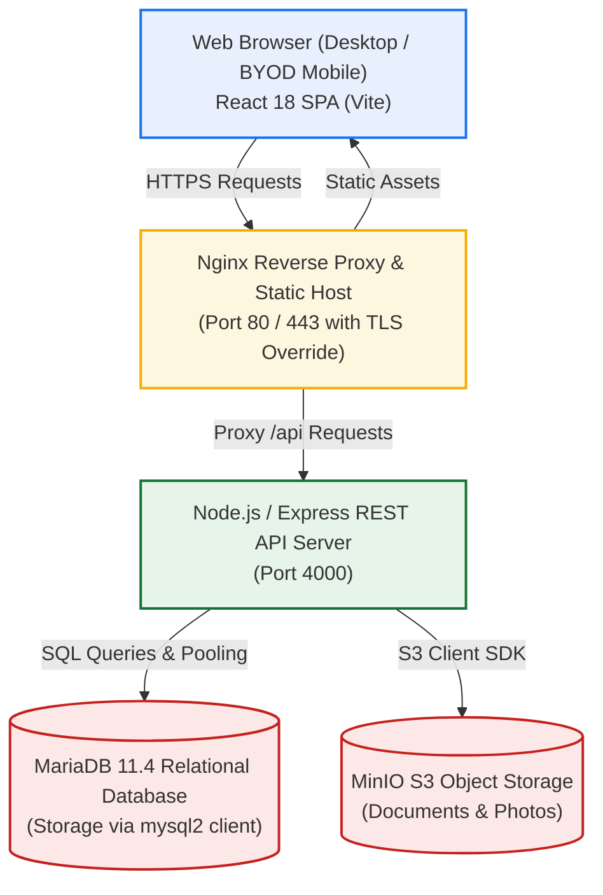
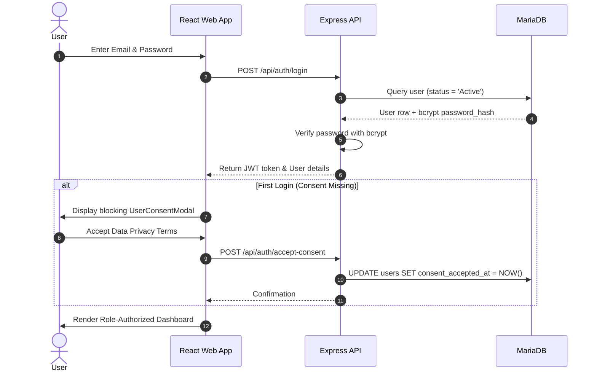

# F1KD Digital Health Monitoring System: Project & System Overview
**Institution:** Southwestern University PHINMA — Community Development Department (ComDev)  
**Project Team:** TEODORO, EDZHEL M. & LAUREA, ANGELICA C.  
**Document Version:** 1.2 (Post-Implementation System Verification)  
**Date:** October 26, 2026  

---

## Revision History

| Version | Date | Change Description | Author/s |
|:---:|:---:|---|---|
| **1.0** | September 14, 2026 | Initial proposal draft incorporating P1 Milestone Check feedback. | Teodoro, E. & Laurea, A. |
| **1.1** | October 05, 2026 | Capstone 2 documentation update, governance frameworks, and policy drafts. | Teodoro, E. & Laurea, A. |
| **1.2** | October 26, 2026 | Comprehensive system verification update: synchronized all modules, updated simplified diagrams, corrected AI access limits, detailed PhilHealth and photo upload rules, and embedded Acceptable Use Policy. | Teodoro, E. & Laurea, A. |

---

## Table of Contents
1. Executive Summary  
2. Project General Information  
   2.1 Stakeholders & Points of Contact  
   2.2 Project Objectives  
   2.3 Success Criteria  
3. System Architecture & Technical Specifications  
   3.1 Architecture Overview & Technology Stack  
   3.2 User Feedback & UX Design Iterations  
   3.3 Simplified System Business Flows (Mermaid)  
   3.4 Master Permission Matrix  
   3.5 Database Entities & Storage Design  
   3.6 Deployment Environments & Service Accounts  
4. Functional Requirements Inventory  
5. Governance Framework  
   5.1 Roles and Responsibilities  
   5.2 Code Standards & Conventions  
   5.3 Deployment & Environment Standards  
   5.4 Security & Data Privacy Compliance (RA 10173)  
   5.5 Acceptable Use Policy (AUP)  
   5.6 Support Escalation Tiers  
6. Implementation Plan, Milestones, and Budget  
7. Risk Assessment & Mitigation Strategies  
8. Institutional Sign-Off  

---

## 1. Executive Summary
The F1KD Digital Health Monitoring System is a centralized enterprise web platform developed for Southwestern University PHINMA Community Development Department (ComDev) to manage and monitor maternal and pediatric health information under the Philippine First 1,000 Days Program. Replacing manual paper logs and disparate spreadsheets, the platform provides authorized users with structured tools for beneficiary tracking, clinical health monitoring, vaccination records, supplementary feeding documentation, and automated reminder alerts.

---

## 2. Project General Information

### 2.1 Stakeholders & Points of Contact
* **Primary Stakeholder:** Southwestern University PHINMA — Community Development Department (ComDev)
* **Client Contact:** Engr. Smith Booc, Program Head (`sbooc.swu@phinmaed.com`)
* **Project Developers / Researchers:**
  * Teodoro, Edzhel M. — Lead Developer & Architecture
  * Laurea, Angelica C. — Systems Analyst & Quality Assurance

### 2.2 Project Objectives
1. Centralize maternal and child health records into a secure, relational database.
2. Enforce authoritative Role-Based Access Control (RBAC) and school/group geographic scoping at the API layer.
3. Automate pediatric growth assessment using World Health Organization (WHO) anthropometric standards.
4. Implement daily automated check-up reminders (Asia/Manila time) to reduce missed clinical visits.
5. Provide auditable progress reporting and CSV data exports compliant with the Data Privacy Act of 2012 (RA 10173).

### 2.3 Success Criteria
* 100% replacement of manual paper forms for beneficiary intake and clinical monitoring in participating schools.
* Verified backend API enforcement preventing cross-school data leaks and unauthorized role actions.
* Flawless execution of the daily reminder scheduler at 08:00 AM Manila time across all four alert stages.
* Complete institutional sign-off on the BYOD Policy, Acceptable Use Policy, and system user manuals.

---

## 3. System Architecture & Technical Specifications

### 3.1 Architecture Overview & Technology Stack



* **Client Layer:** React 18, React Router v6, Tailwind CSS tokens, Vite builder.
* **Server Layer:** Node.js v20+, Express.js, JWT authentication, Bcrypt password hashing.
* **Database Layer:** MariaDB 11.4 Community Server (`mysql2` promise pool).
* **Document Storage:** MinIO S3-compatible object storage for birth certificates, consent scans, and photo sets.
* **Orchestration:** Docker Compose (`docker-compose.minio.yml`, optional `docker-compose.tls.yml`).

### 3.2 User Feedback & UX Design Iterations
* **Challenge:** Coordinators struggled to identify whether to create a school, group, or batch from one single toolbar button.  
  * *Resolution:* Implemented a contextual dropdown menu (`CommunityToolbar.jsx`) offering explicit actions: Create School (Super Admin only), Create Group, and Create Batch.
* **Challenge:** Health Workers experienced cognitive overload when reviewing cross-community rosters.  
  * *Resolution:* Filtered all beneficiary lists and dashboards strictly by the worker’s assigned `group_id`.
* **Challenge:** Slow reporting turnaround using external spreadsheets.  
  * *Resolution:* Built the internal Progress Report module with automated WHO growth classification and one-click CSV exporting.

### 3.3 Simplified System Business Flows

#### Flow 1: Authentication & Privacy Consent Gating


#### Flow 2: Community Hierarchy & Scoping
```mermaid
flowchart TD
    classDef sa fill:#fce8e6,stroke:#c5221f,stroke-width:2px;
    classDef cc fill:#e8f0fe,stroke:#1a73e8,stroke-width:2px;
    classDef hw fill:#e6f4ea,stroke:#137333,stroke-width:2px;

    SA["Super Admin"]:::sa
    CC["Community Coordinator"]:::cc
    HW["Health Worker"]:::hw

    School["School / Community Level\n(Created/Deleted by Super Admin Only)"]
    Groups["Operational Groups\n(Managed by Coordinator)"]
    Batches["Beneficiary Batches\n(Managed by Coordinator)"]
    Beneficiaries["Mothers & Children Profiles"]

    SA -->|Creates School & Binds Coordinator| School
    CC -->|Assigned to School (school_id)| School
    CC -->|Creates Groups within School| Groups
    CC -->|Creates Batches & Uploads Photos| Batches
    HW -->|Assigned to Group (group_id)| Groups
    Groups --> Beneficiaries
    Batches --> Beneficiaries
```

#### Flow 3: Health Monitoring & Automated Reminder Lifecycle

```mermaid
flowchart TD
    classDef visit fill:#e8f0fe,stroke:#1a73e8,stroke-width:2px;
    classDef cron fill:#fef7e0,stroke:#f9ab00,stroke-width:2px;
    classDef notif fill:#e6f4ea,stroke:#137333,stroke-width:2px;

    Visit["Health Visit Recorded\n(Coordinator or Health Worker)"]:::visit
    DB[("Save Check-up & Next Date\nto mother_checkups / child_checkups")]:::visit
    Cron["Daily Reminder Scheduler\nRuns at 08:00 AM (Asia/Manila)"]:::cron

    Visit --> DB
    Cron --> ScanSchedule{"Compare next_checkup_date\nagainst current date\n(Excludes Completed/Cancelled)"}:::cron

    ScanSchedule -->|Due in 3 Days| S1["Stage 1: Upcoming Check-Up"]:::notif
    ScanSchedule -->|Due in 1 Day| S2["Stage 2: Check-Up Tomorrow"]:::notif
    ScanSchedule -->|Due Today| S3["Stage 3: Check-Up Due Today"]:::notif
    ScanSchedule -->|Missed 1 Day Ago| S4["Stage 4: Missed Check-Up Warning"]:::notif

    S1 --> TargetStaff["Idempotent Insert into notifications\nTargeted to Assigned Coordinator & Group Workers"]:::notif
    S2 --> TargetStaff
    S3 --> TargetStaff
    S4 --> TargetStaff
```


### 3.4 Master Permission Matrix

| Module / Operation | Super Admin | Administrator | Community Coordinator | Health Worker | Partner |
|---|:---:|:---:|:---:|:---:|:---:|
| **Dashboard** | Admin Views | Operational View | School Scope | Group Scope | Partner View |
| **School Management (CRUD)** | Full CRUD | Read-Only | Denied (403) | Denied (403) | Read-Only |
| **Group & Batch Management** | Full CRUD | Read-Only | School Write | Read-Only | Read-Only |
| **Batch Photo Evidence (3–10)**| No Access | View/Download | Upload/Delete | View/Download | View/Download |
| **Beneficiary Intake (Create)**| No Access | Read-Only | School Write | Denied (403) | Read-Only |
| **Beneficiary Profile Updates**| No Access | Read-Only | School Write | Group Limited | Read-Only |
| **Clinical Check-ups (Write)** | No Access | Read-Only | School Write | Group Write | Read-Only |
| **Immunization Records Entry** | No Access | Read-Only | School Write | Group Write | Read-Only |
| **Program Setup & Clusters** | Denied (403) | Read-Only | School Write | Denied (403) | Read-Only |
| **Program Check-In Receipts** | Denied (403) | Read-Only | School Write | Group Write | Read-Only |
| **Progress Report & Export** | Denied (403) | Global Export | School Export | Group Export | Global Export |
| **Global User Administration** | Full CRUD | No Access | Health Workers | No Access | No Access |
| **Activity & Sign-In Reports** | Full UI/API | No Access | Scoped API Only | No Access | No Access |
| **Check-up Daily Reminders** | Excluded | Excluded | School Recipient| Group Recipient| Excluded |
| **AI Report Query Builder** | Denied (403) | Full Access | Full Access | Full Access | Full Access |
| **AI Dashboard Insight** | Full Access | Full Access | Full Access | Full Access | Full Access |

### 3.5 Database Entities & Storage Design
The active schema is defined in `server/create_users.sql`, `server/f1kd_recreate.sql`, and `server/DB_SCHEMA.md`:
* **`users`:** Accounts, bcrypt password hashes, canonical roles, status (`Active`/`Suspended`), `school_id`, `group_id`, `consent_accepted_at`.
* **`communities`:** Schools/communities, name, area, `coordinator_id` (enforces 1-to-1 binding with unique key).
* **`groups` & `batches`:** Operational sub-units and beneficiary cohorts linked to `communities`.
* **`batch_documentations` & `batch_documentation_sets`:** Dated photo evidence sets attached to batches (3–10 photos).
* **`mothers` & `children`:** Core beneficiary demographics, obstetric risk factors, PhilHealth numbers, birth measurements.
* **`philhealth_claims`:** PhilHealth claim tracking numbers, status, and hospitalization assistance logs.
* **`mother_checkups` & `child_checkups`:** Clinical prenatal visits, blood pressure, weight, pediatric visits, WHO growth indices.
* **`mother_vaccinations` & `child_vaccinations`:** Chronological vaccine dose administration dates and remarks.
* **`programs`, `program_clusters`, `monitoring_logs`:** Program definitions, target scopes, and beneficiary service receipts.
* **`program_receipt_documentations`:** Photo documentation sets attached to bulk program service check-ins.
* **`notifications`, `notification_reads`, `notification_preferences`:** Event alerts, independent per-user read tracking, category filters.
* **`activity_logs`:** System audit trail tracking sign-ins, account lifecycle actions, and report export downloads.

### 3.6 Deployment Environments & Service Accounts
The codebase is validated in local Docker containers. Production and staging environments represent the approved target infrastructure model:

| Parameter | Local Development (Active) | Staging / UAT (Target Model) | Production (Target Model) |
|---|---|---|---|
| **Web Host** | `http://localhost:5173` (Vite) / Docker | Campus staging host | Dedicated ComDev institutional domain |
| **REST API Host** | `http://localhost:4000` | Port-mapped staging container | Hardened Node.js cluster behind Nginx |
| **Database Host** | MariaDB 11.4 container (`f1kd` DB) | MariaDB staging instance | Replicated MariaDB with TLS & backups |
| **Storage Host** | MinIO container (`localhost:9000`) | S3 staging bucket | High-availability object storage |
| **Credentials** | Root `.env` environment variables | Secure container secrets manager | Protected environment vaults |

---

## 4. Functional Requirements Inventory

1. **Authentication & Access Gating:** Bcrypt hashing, JWT issuance, rate limiting, and mandatory data privacy consent gating before module access.
2. **Community Management:** 3-tier organizational structure (School -> Group -> Batch). Super Admin manages schools; Coordinators manage groups and batches. Batch photo evidence uploads (3–10 photos, max 5MB each).
3. **Beneficiary Profile Tracking:** Intake of pregnant mothers and newborns by Coordinators. Obstetric histories, EDD calculation, APGAR tracking, and 12-digit PhilHealth PIN validation (`XX-XXXXXXXXX-X`).
4. **Health Monitoring & Growth Standards:** Maternal trimester visits and pediatric visits through 24 months. Automated evaluation of WHO growth z-scores (Stunting, Underweight, Wasting).
5. **Immunization Tracking:** Tracking for child vaccines (doses 1–3 for BCG, HepB, IPV, OPV, PCV, DPT, MMR) and maternal Tetanus Toxoid (TT1–TT5).
6. **Program Delivery & Check-Ins:** Program setup by Coordinators; check-in receipt entry by Coordinators and group Health Workers. Optional 3–10 photo evidence sets per submission.
7. **Progress Reporting & Export Auditing:** Multi-parameter filtering (school, group, batch, date). CSV and print exports automatically generate an audit log entry (`download.progress_report.csv`).
8. **Automated Reminders:** Daily cron scheduler running at 08:00 AM Manila time generating 4-stage idempotent alerts (3-day, 1-day, day-of, missed-yesterday) routed to assigned staff.
9. **User Management:** Super Admin global account CRUD. Scoped Health Worker management for Coordinators. Account suspension and reactivation.
10. **System Activity Reporting:** Super Admin sign-in frequencies (excluding Super Admin to preserve metric accuracy) and chronological activity audit trails.
11. **Integrated AI Assistants:** Optional Groq Cloud LLM integration for dashboard summaries, report query generation, and monitoring table filtering. PII is redacted prior to prompt transmission.

---

## 5. Governance Framework

### 5.1 Roles and Responsibilities Summary
* **Super Admin:** System-wide governance, account management, school creation, activity auditing. Completely excluded from operational records.
* **Administrator:** Global operational oversight across all schools; read-only; progress report exports.
* **Community Coordinator (Organizer):** Field manager for assigned school; beneficiary intake, clinical monitoring, program setup, Health Worker user management.
* **Health Worker:** Frontline worker for assigned group; check-up entries, vaccine recording, program receipts, limited profile updates.
* **Partner:** Community partner review; global read-only access to program delivery and community indicators.

### 5.2 Code Standards & Conventions
* **Frontend:** React functional components, hooks, PascalCase component names, feature-oriented folder structure.
* **Backend:** Express modular routers, centralized error middleware, snake_case database columns.
* **Naming:** Variables in `camelCase`, constants in `UPPER_SNAKE_CASE`, boolean flags prefixed with `is`, `has`, or `can`.

### 5.3 Deployment & Environment Standards
* Environment variables stored in `.env` (never committed to GitHub; `.env.example` provided).
* Database migrations tracked sequentially in `server/migrations/`.
* Docker Compose used for consistent local service orchestration.

### 5.4 Security & Data Privacy Compliance (RA 10173)
* The system classifies beneficiary records, medical histories, and PhilHealth PINs as **Sensitive Personal Information (SPI)**.
* API enforces authentication and RBAC authoritatively on every request.
* Plaintext passwords are never stored or logged.

### 5.5 Acceptable Use Policy (AUP)
* Authorized program activities only; unauthorized personal use prohibited.
* Users must never attempt to bypass API restrictions or manipulate parameters.
* Downloading, distributing, or extracting beneficiary SPI to unauthorized personal devices or cloud storage is strictly prohibited.
* Workstations must be locked when unattended, and sessions terminated via Sign Out.

### 5.6 Support Escalation Tiers
* **Tier 1 (Frontline IT Support):** Account access, password resets, browser caching, BYOD setup. (Target: within 1 working day).
* **Tier 2 (Community Coordinator / Administrator):** Clinical data corrections, group reassignments, report discrepancies. (Target: 1–2 working days).
* **Tier 3 (Super Admin / Systems Engineering):** Server outages, database repairs, security investigations, account deletions. (Target: immediate to 24 hours).

---

## 6. Implementation Plan, Milestones, and Budget

### Project Timeline
* **Weeks 1–2:** Planning, stakeholder interviews, and Software Requirements Specification (SRS).
* **Weeks 3–4:** System architecture, database modeling, and UI wireframing.
* **Weeks 5–10:** Core development (Auth, RBAC, Communities, Beneficiaries, Monitoring, Programs).
* **Weeks 11–13:** Integration testing, automated reminder scheduler, and export auditing.
* **Weeks 14–15:** Containerization, user manual documentation, and staff training.
* **Weeks 16–17:** System evaluation, final revisions, and institutional sign-off.

### Capstone Budget Outlay
* **Software Tools (React, Node, MariaDB, Docker, GitHub):** ₱0 (Open Source)
* **Hardware:** ₱0 (Existing student/institutional computers)
* **Connectivity & Container Downloads:** ₱2,500
* **Documentation, Printing & Binding:** ₱1,500
* **Developer Labor (2 Student Researchers):** ₱0 (Capstone requirement)
* **Total Direct Project Outlay:** **₱4,000**

---

## 7. Risk Assessment & Mitigation Strategies

| Identified Risk | Severity | Mitigation Strategy Implemented |
|---|:---:|---|
| **Data Privacy Breach** | High | Enforced strict backend API scoping, password hashing, and export audit trails. |
| **Inaccurate Child Growth Assessment** | High | Automated WHO growth z-score calculations using verified international lookups. |
| **Missed Check-up Visits** | Medium | Automated daily reminder scheduler firing 4-stage alerts at 08:00 AM Manila time. |
| **Unauthorized Data Modification** | High | Enforced read-only middleware for Admin/Partner and group write perimeters for Health Workers. |
| **Lost Personal BYOD Device** | Medium | Implemented immediate token revocation, account suspension, and remote session termination. |

---

## 8. Institutional Sign-Off

| Role | Name & Designation | Signature | Date |
|---|---|---|---|
| **Lead Developer / Researcher** | Teodoro, Edzhel M. | ____________________ | 2026-10-26 |
| **Systems Analyst / Researcher** | Laurea, Angelica C. | ____________________ | 2026-10-26 |
| **ComDev Program Head / Client** | Engr. Smith Booc | ____________________ | 2026-10-26 |
| **Dean / Department Head** | College of Information Technology, SWU PHINMA | ____________________ | 2026-10-26 |

---
*End of Project & System Overview Document.*
