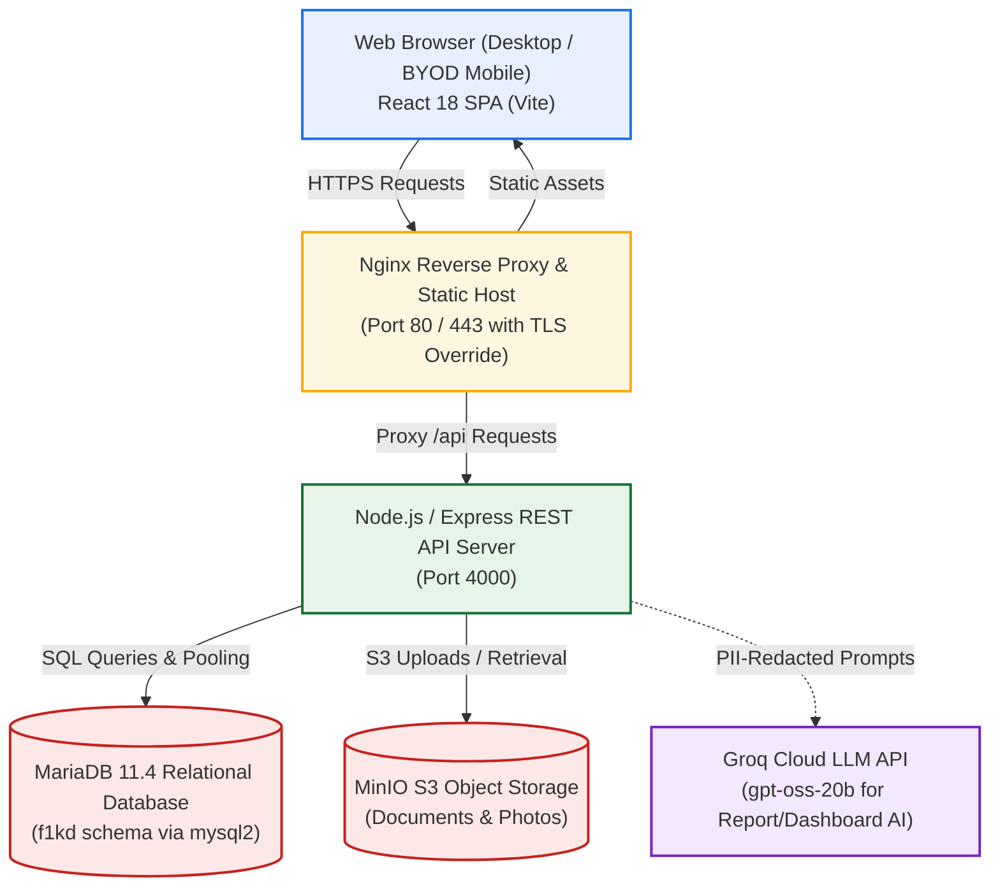
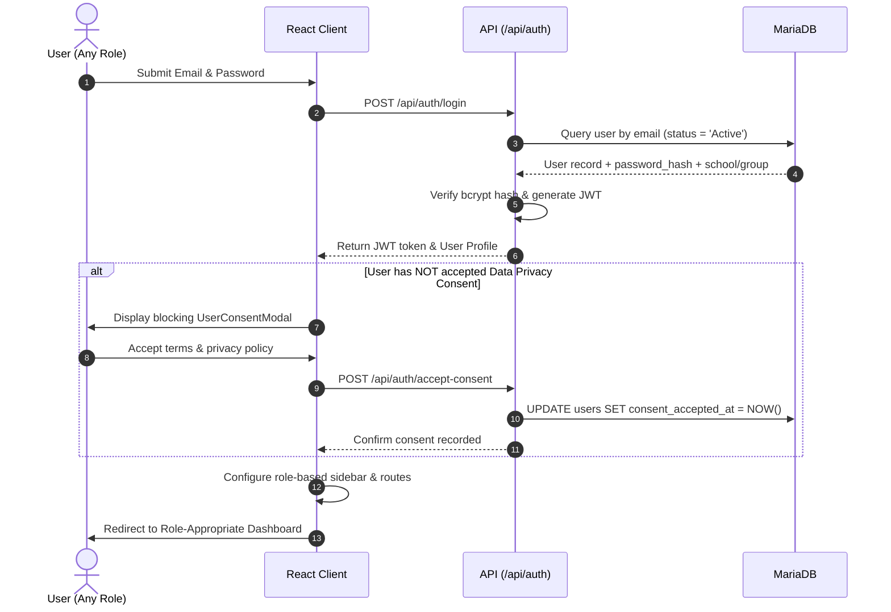
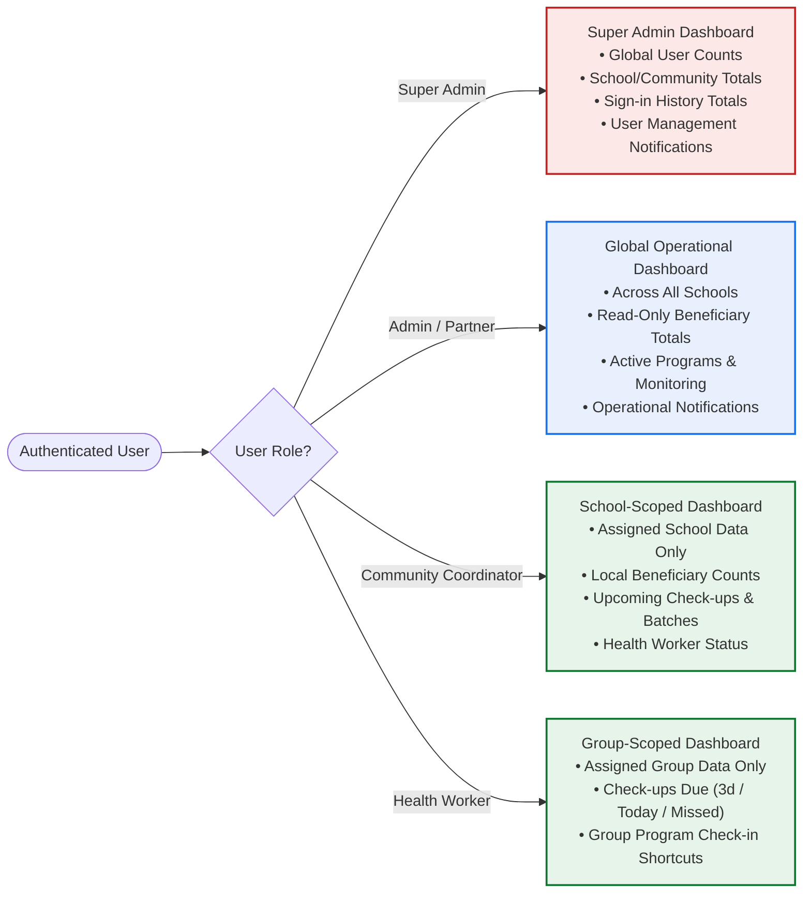
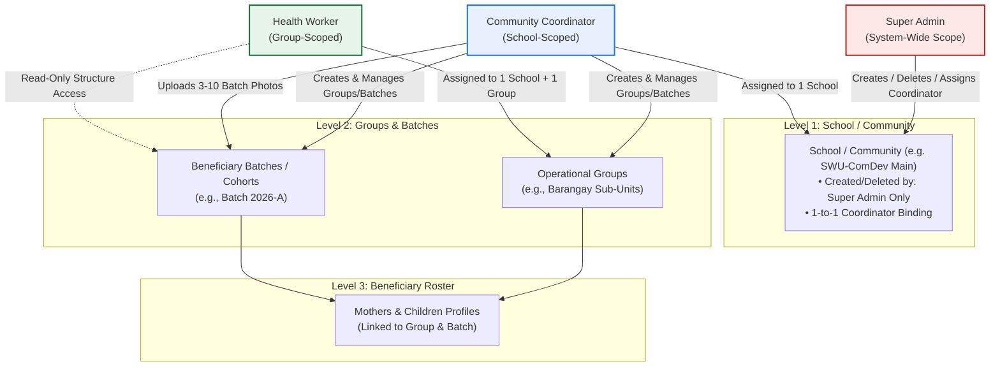
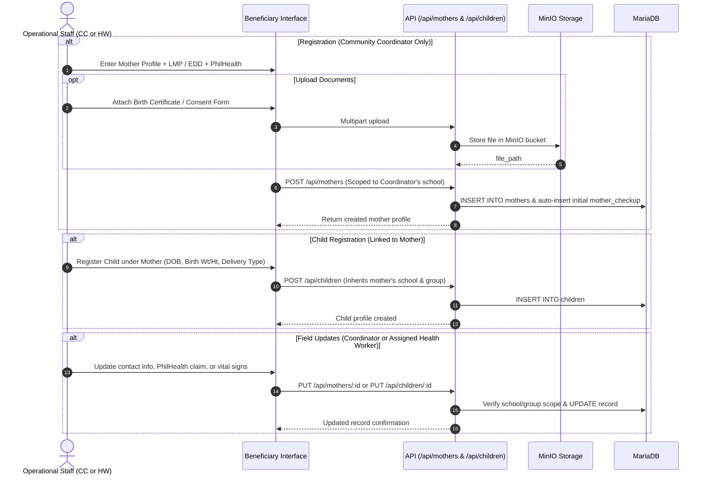
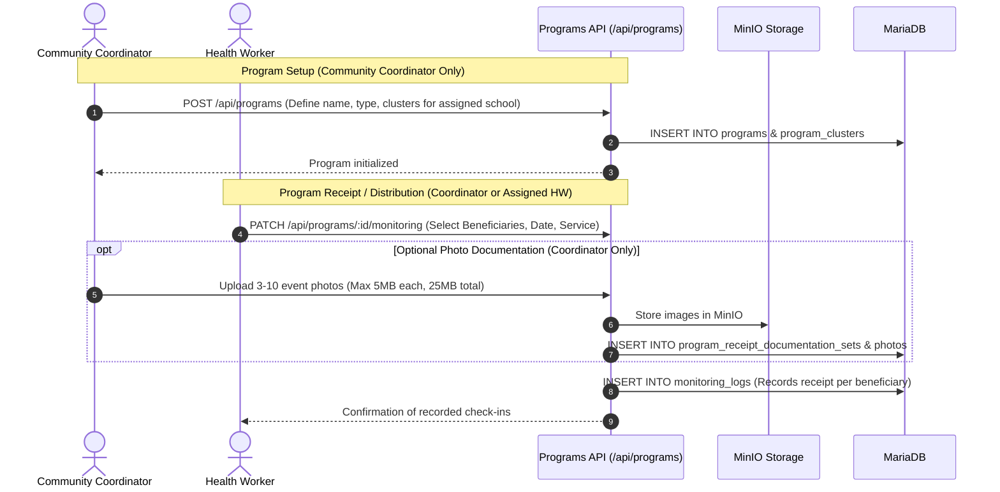
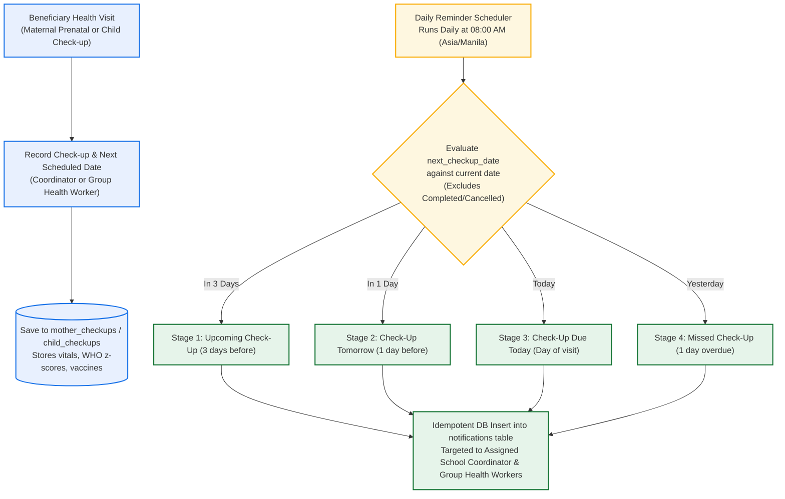
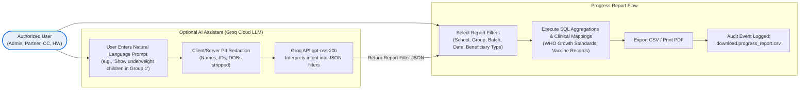
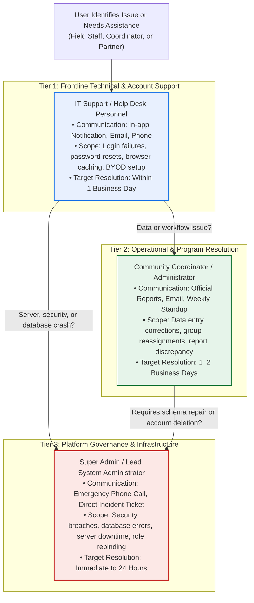

# F1KD System Documentation Review, Validation, and Diagram Simplification Report
**Organization:** Southwestern University PHINMA — Community Development Department (ComDev)  
**System:** First 1,000 Days (F1KD) Digital Health Monitoring System  
**Date:** October 26, 2026  
**Auditors & Developers:** Teodoro, Edzhel M. & Laurea, Angelica C.  

---

## 1. Executive Summary

This report delivers the results of an exhaustive code-level review and verification of the **F1KD Digital Health Monitoring System** against all project documentation. The inspection encompassed frontend components (`src/`), backend REST API routes and services (`server/`), middleware (`server/middleware/`), database schemas and migration scripts (`server/create_users.sql`, `server/f1kd_recreate.sql`, `server/DB_SCHEMA.md`), and automated test suites.

All inconsistencies have been resolved, and the updated official documentation has been committed into the repository:
* [docs/BYOD_POLICY.md](BYOD_POLICY.md) — Updated Bring-Your-Own-Device Policy (SWU_008).
* [docs/FULL_MANUAL_GUIDE.md](FULL_MANUAL_GUIDE.md) — Updated 18-Section Full User Manual Guide (v1.1).
* [docs/PROJECT_OVERVIEW.md](PROJECT_OVERVIEW.md) — Updated Capstone Project & System Overview (v1.2) with embedded Acceptable Use Policy.
* [docs/INTEGRATED_AI.md](INTEGRATED_AI.md) — Corrected role access matrix for AI assistants.

---

## 2. Simplified and Updated System Diagrams

The congested and redundant legacy diagrams have been redesigned using clean Mermaid flowcharts and sequence diagrams. Each diagram preserves essential decision points and backend authorization rules while eliminating technical clutter.

### 2.1 System Architecture

### 2.2 Business Flow 1: Authentication, Mandatory Consent, and Session Initialization

### 2.3 Business Flow 2: Role-Based Dashboard & Scoped Access

### 2.4 Business Flow 3: Community & School Hierarchy Management

### 2.5 Business Flow 4: Beneficiary Lifecycle (Intake to Clinical Tracking)

### 2.6 Business Flow 5: Program Management & Receipt Check-In

### 2.7 Business Flow 6: Health Monitoring & Daily Reminder Lifecycle

### 2.8 Business Flow 7: Progress Reporting & Privacy-Preserving AI

### 2.9 Support Escalation Flow

---

## 3. Complete User-Role Inventory

The five canonical roles are verified as follows:

### 3.1 Super Admin (`super_admin`)
1. **Purpose:** System-wide account administration, school governance, and activity auditing.
2. **Authorized Modules:** Dashboard (admin view), Community (global school CRUD), User Management (global), Reports (`/reports`), Notifications, Profile, Settings.
3. **Permitted Actions:** Full account CRUD across all roles; School creation/deletion; System activity inspection.
4. **Data Scope:** System-wide global administrative scope.
5. **Restrictions:** **Excluded from all operational modules** (Beneficiaries, Monitoring, Programs, Progress Reports).
6. **Account Management:** Can create, edit, suspend, reactivate, and permanently delete all users.
7. **Reports:** System activity logs and login frequency reports.
8. **Notifications:** Global administrative categories (`User Management`, `Community`).
9. **Authentication:** Bcrypt-hashed credentials; JWT contains `role: 'super_admin'`.
10. **Auditability:** Sign-ins and administrative changes are recorded in `activity_logs`. Super Admin logins are excluded from operational user login totals.

### 3.2 Administrator (`admin`)
1. **Purpose:** Institutional oversight and program monitoring.
2. **Authorized Modules:** Dashboard, Community (read-only), Beneficiaries (read-only), Monitoring (read-only), Programs (read-only), Progress Report (read and export), Notifications, Profile, Settings.
3. **Permitted Actions:** Read-only inspection of operational records; Export Progress Reports.
4. **Data Scope:** Global operational scope across all schools.
5. **Restrictions:** All operational writes are denied by the API; cannot manage accounts or access `/reports`.
6. **Account Management:** None.
7. **Reports:** Can filter and export Progress Reports (CSV/print).
8. **Notifications:** Global operational notifications (`Beneficiaries`, `Monitoring`, `Programs`, `Downloads`, `Community`).
9. **Authentication:** JWT contains `role: 'admin'`; authorize middleware enforces read-only access.
10. **Auditability:** Progress Report exports trigger audit entries (`download.progress_report.csv`).

### 3.3 Partner (`partner`)
1. **Purpose:** External collaborator review of community programs.
2. **Authorized Modules:** Dashboard (partner-oriented cards), Community (read-only), Beneficiaries (read-only), Monitoring (read-only), Programs (read-only), Progress Report (read and export), Notifications, Profile, Settings.
3. **Permitted Actions:** Inspect program coverage and community metrics; Export Progress Reports.
4. **Data Scope:** Global operational read scope.
5. **Restrictions:** All operational writes are denied; no account administration access.
6. **Account Management:** None.
7. **Reports:** Progress Report viewing and export.
8. **Notifications:** Global operational notifications.
9. **Authentication:** JWT contains `role: 'partner'`.
10. **Auditability:** Report exports are audited.

### 3.4 Community Coordinator (`community_coordinator`)
*Alias: Community Organizer*
1. **Purpose:** Field operational management and clinical coordination within an assigned school.
2. **Authorized Modules:** Dashboard, Community (school write), Beneficiaries (full intake), Monitoring (clinical write), Programs (program setup and receipts), Progress Report (school export), User Management (Health Workers only), Notifications, Profile, Settings.
3. **Permitted Actions:** Register mothers/children; record check-ups and vaccines; create groups/batches; upload 3–10 batch/program photos; manage Health Worker accounts.
4. **Data Scope:** Strictly limited to the assigned school (`school_id`).
5. **Restrictions:** **Cannot create or delete schools**; cannot modify records outside assigned school; cannot permanently delete user accounts.
6. **Account Management:** Scoped User Management for Health Workers in their school.
7. **Reports:** School Progress Reports; Health Worker activity logs via scoped API.
8. **Notifications:** School operational notifications and automated check-up reminders.
9. **Authentication:** JWT contains `role: 'community_coordinator'` and `school_id`.
10. **Auditability:** All clinical updates, beneficiary registrations, and Health Worker creations are logged in `activity_logs`.

### 3.5 Health Worker (`health_worker`)
1. **Purpose:** Frontline clinical monitoring and program receipt collection.
2. **Authorized Modules:** Dashboard, Community (group read-only), Beneficiaries (limited group profile updates), Monitoring (check-ups and vaccines write), Programs (receipt entry write), Progress Report (group export), Notifications, Profile, Settings.
3. **Permitted Actions:** Record maternal/pediatric check-ups; record vaccines; record program receipts for assigned group; update contact info and PhilHealth PINs.
4. **Data Scope:** Strictly limited to assigned school (`school_id`) and assigned group (`group_id`).
5. **Restrictions:** **Cannot register new beneficiaries**; cannot delete records; cannot create programs; cannot manage accounts; cannot modify community structures.
6. **Account Management:** None.
7. **Reports:** Group-filtered Progress Reports.
8. **Notifications:** Group check-up reminders (3-day, 1-day, today, missed).
9. **Authentication:** JWT contains `role: 'health_worker'`, `school_id`, and `group_id`.
10. **Auditability:** Check-up creations, vital updates, and receipt submissions are audited.

---

## 4. Master Role-Permission Matrix

| Resource / Action | Super Admin | Administrator | Community Coordinator | Health Worker | Partner |
|---|:---:|:---:|:---:|:---:|:---:|
| **Access System Dashboard** | Admin Views | Operational View | School Scope | Group Scope | Partner View |
| **Manage Schools (Create / Delete)** | **Yes** | No | No (403 Denied) | No | No |
| **Manage Groups & Batches (Create / Edit)** | **Yes** | No | **Yes (Own School)** | No (Read-Only) | No |
| **Upload Batch Documentation Photos (3–10)** | No | View / Download | **Yes (Own School)** | View / Download | View / Download |
| **Register New Mother / Child Beneficiary** | No Access | No | **Yes (Own School)** | No (403 Denied) | No |
| **Edit Beneficiary Profile Details** | No Access | No | **Yes (Own School)** | **Limited (Own Group)** | No |
| **Delete Beneficiary Records** | No Access | No | **Yes (Own School)** | No | No |
| **Record Maternal / Child Check-ups** | No Access | No | **Yes (Own School)** | **Yes (Own Group)** | No |
| **Record Immunization Doses** | No Access | No | **Yes (Own School)** | **Yes (Own Group)** | No |
| **Create / Configure Programs & Clusters** | No (403 Denied) | No | **Yes (Own School)** | No | No |
| **Record Program Receipt / Check-In** | No (403 Denied) | No | **Yes (Own School)** | **Yes (Own Group)** | No |
| **Upload Program Check-In Photos** | No | View / Download | **Yes (Own School)** | View / Download | View / Download |
| **Generate & Export Progress Reports** | No (403 Denied) | **Yes (Global)** | **Yes (Own School)** | **Yes (Own Group)** | **Yes (Global)** |
| **Global User Management (Full CRUD)** | **Yes** | No | No | No | No |
| **Manage Health Worker Accounts** | **Yes** | No | **Yes (Own School)** | No | No |
| **Permanently Delete User Accounts** | **Yes** | No | No | No | No |
| **View System Sign-in & Activity Reports** | **Yes (Full UI)** | No | API Only (Own HWs) | No | No |
| **Receive Daily Check-up Reminders** | No | No | **Yes (Own School)** | **Yes (Own Group)** | No |
| **Receive User Management Notifications** | **Yes** | No | Local HW Events | No | No |
| **Access AI Report Builder & Filter Assistant** | No (403 Denied) | **Yes** | **Yes** | **Yes** | **Yes** |
| **Access AI Dashboard Summary Insight** | **Yes** | **Yes** | **Yes** | **Yes** | **Yes** |

---

## 5. Documentation-to-Implementation Comparison

| Architectural Feature / Claim | Documented Claim | Verified Codebase Status | Status | Evidence in Codebase |
|---|---|---|:---:|---|
| **Role Normalization** | 5 distinct roles. | Normalized via `ROLE_ALIASES`. | **Matched** | `server/middleware/authorize.js` line 1 |
| **Super Admin Module Exclusions** | Barred from Beneficiaries, Monitoring, Programs, Progress Reports. | Enforced in `programs.js`, `progressReport.js`, and `src/App.jsx`. | **Matched** | API returns HTTP 403 on disallowed routes. |
| **School Creation Restraints** | Coordinators cannot create or delete schools. | `isSchoolCreate` and `isSchoolDelete` rejected with 403. | **Matched** | `server/middleware/authorize.js` lines 127–129 |
| **Coordinator User Administration** | Coordinators manage own Health Workers only. | Dedicated routes `/api/users/health-workers` enforce school ID. | **Matched** | `server/routes/users.js` lines 67–348 |
| **Batch Photo Constraints** | Batches allow photo uploads. | Enforces 3–10 photos, max 5MB each, max 25MB total. | **Matched** | `server/routes/community.js` lines 104–120 |
| **PhilHealth Claims Module** | PhilHealth integration. | Validates 12-digit PIN `XX-XXXXXXXXX-X`; tracks claims in `philhealth_claims`. | **Matched** | `server/routes/mothers.js` lines 960–1087 |
| **Automated Reminders** | System alerts for checkups. | 08:00 AM Manila cron; 4 idempotent stages (3d, 1d, today, missed). | **Matched** | `server/services/checkupReminders.js` lines 5–30 |
| **Per-User Read State** | Independent read receipts. | Composite primary key (`notification_id`, `user_id`) in `notification_reads`. | **Matched** | `server/routes/notifications.js` |
| **Report Export Auditing** | Exports are audited. | `download.progress_report.csv` recorded in `activity_logs`. | **Matched** | `server/routes/notifications.js` line 328 |
| **AI Assistant Permissions** | Older doc listed Super Admin on all AI. | Code denies Super Admin on Monitoring AI and Proposal AI. | **Corrected** | `server/middleware/authorize.js` line 167; updated `docs/INTEGRATED_AI.md`. |

---

## 6. Discrepancy & Remediation Summary

1. **Integrated AI Documentation Inconsistency (`docs/INTEGRATED_AI.md`):**  
   * *Finding:* Row 19 of `docs/INTEGRATED_AI.md` erroneously listed `Super Admin` as having access to the Monitoring Check-up Report Assistant.  
   * *Resolution:* Edited `docs/INTEGRATED_AI.md` to reflect that `Super Admin` is explicitly denied access (HTTP 403) by `authorizeProgressReport`.
2. **Environment & Service Accounts Specification:**  
   * *Finding:* Older documents listed Production and UAT hosts as active external environments, whereas the repository contains local Docker Compose and Vite dev configurations.  
   * *Resolution:* Clarified in `PROJECT_OVERVIEW.md` that active configurations are local container deployments and that remote cloud environments represent target institutional architectures.
3. **Missing PhilHealth & Photo Constraint Documentation:**  
   * *Finding:* Older user guides omitted the 12-digit PhilHealth PIN format, the `philhealth_claims` module, and the 3–10 photo batch documentation limits.  
   * *Resolution:* Fully integrated into `FULL_MANUAL_GUIDE.md` and `PROJECT_OVERVIEW.md`.

---
*End of Validation Report.*
